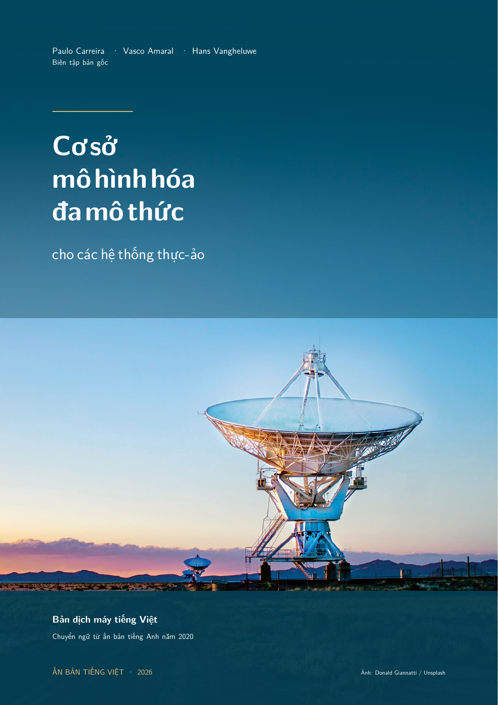

# Cơ sở mô hình hóa đa mô thức cho các hệ thống thực-ảo

[English](README_EN.md)

**[Machine Translated, Not Reviewed]**

Bản dịch máy này chưa được con người rà soát chuyên môn. Các lượt kiểm tra bằng
AI dưới đây không thay thế việc đối chiếu với sách gốc hoặc đánh giá học thuật.

Dự án thuộc [XanclockTranslations](https://github.com/XanclockTranslations).
[Kho nguồn](https://github.com/XanclockTranslations/foundations-mpm4cps-vi) ·
[Góp ý và báo lỗi](https://github.com/XanclockTranslations/foundations-mpm4cps-vi/issues).



Bản dịch máy tiếng Việt của *Foundations of Multi-Paradigm Modelling for
Cyber-Physical Systems*, do Paulo Carreira, Vasco Amaral và Hans Vangheluwe
biên tập, Springer, 2020. [Sách gốc và DOI](https://doi.org/10.1007/978-3-030-43946-0).

Bản đọc A4 có **355 trang**, gồm phần mở đầu, 9 chương, 157 hình
đánh số, 11 bảng, 6 sơ đồ bài tập và 310 mục tài liệu tham khảo. Kho nguồn có
181 tệp PDF hình minh họa, bao gồm các trích đoạn phóng lớn và ô hình của Bảng 4.1.
LaTeX được tái dựng từ PDF của nhà xuất bản để có thể chỉnh sửa.

AI sử dụng: **GPT-6.1 Sol (Ultra)**. Người thực hiện prompting:
**Bế Trọng Nghĩa (@ichxorya)**. Các tác nhân AI riêng đã đối chiếu nguồn và
bản dịch, hình minh họa và bố cục. Đây là bản dịch độc lập; các báo cáo đó
không xác nhận sự phê duyệt của tác giả, nhà xuất bản hay chuyên gia con người.
Phạm vi rà soát và các giới hạn được ghi trong [hồ sơ rà soát](docs/review/README.md).

## Đọc và chỉnh sửa

PDF bản đọc đã kiểm tra mang tên `foundations-mpm4cps-vi.pdf`; gói nguồn
đi kèm mang tên `foundations-mpm4cps-vi-source.zip`. Các tệp này được giữ cục bộ
trong `release/` và không đưa vào lịch sử Git. Khi tạo bản phát hành trên GitHub,
đính kèm chúng vào GitHub Releases cùng thông tin trong
[manifest phát hành](release/release-manifest.json). Bạn cũng có thể tự dựng PDF.

| Đường dẫn | Nội dung |
|---|---|
| [translation/chapters](translation/chapters) | Nguồn LaTeX chuẩn của 9 chương |
| [translation/frontmatter](translation/frontmatter) | Bìa, lời đầu, thông báo, tác giả và ghi chú biên tập |
| [translation/bibliography.tex](translation/bibliography.tex) | 310 mục tài liệu tham khảo |
| [assets/clean](assets/clean) | 181 PDF hình minh họa đã kiểm tra |
| [assets/figure-crops.json](assets/figure-crops.json) | Nguồn trang, vùng cắt và quan hệ giữa các hình |
| [source/manifest.json](source/manifest.json) | Danh tính, dấu vân tay và ánh xạ trang của sách gốc |
| [source/asset-inventory.json](source/asset-inventory.json) | Danh mục và dấu vân tay tài sản |
| [TRANSLATION_GUIDE.md](TRANSLATION_GUIDE.md) | Thuật ngữ và quy ước biên tập |

Số chương, mục, hình, phương trình và tài liệu tham khảo giữ theo bản gốc;
số trang bản dịch khác nguồn tiếng Anh. Mã, định danh hình thức và dữ liệu số
được giữ lại. Nhãn diễn giải được Việt hóa trực tiếp hoặc bổ sung chú giải.
Các điểm không nhất quán đã xác nhận trong nguồn được giải thích bằng ghi chú
có đánh dấu. Giới hạn của hình quét và giao diện phần mềm còn tiếng Anh được
nêu trong hồ sơ rà soát. PDF tiếng Anh gốc và dữ liệu làm việc không nằm trong
kho nguồn công khai; có thể tìm sách gốc qua DOI ở trên.

## Dựng PDF

Cần **Python 3.12 trở lên**, **pypdf 6.10.0** và
[Tectonic 0.17.0](https://github.com/tectonic-typesetting/tectonic/releases/tag/tectonic%400.17.0)
có trong `PATH`. Tectonic cung cấp Latin Modern và các gói LaTeX từ bộ dữ liệu của nó;
lần dựng đầu có thể cần mạng để tải bộ dữ liệu này.

Chạy từ thư mục gốc của dự án:

```text
python -m pip install -r requirements.txt
python tools/check_project.py
python tools/build_book.py
```

Kết quả là `output/book-draft.tex` và `output/book-draft.pdf`. Chỉnh sửa nguồn
trong `translation/`, rồi dựng lại. Thư mục `output/` được tạo khi dựng và bỏ qua
trong Git. Có thể chỉ định trình biên dịch và thư mục bộ nhớ đệm:

```text
python tools/build_book.py --compiler PATH --cache-dir PATH
```

Trên Windows có thể dùng:

```powershell
.\tools\build_book.ps1 -PythonCommand python -CompilerCommand tectonic
```

Nguồn văn bản dùng UTF-8 và LF; bộ lắp ghép cũng xuất LaTeX theo quy ước đó
trên mọi hệ điều hành. Dấu vân tay phát hành ghi nhận các tệp đã kiểm tra vào
ngày 14-10-2026, gồm bản LaTeX lịch sử dùng CRLF trong gói ZIP. Chúng không phải
lời cam kết PDF mới dựng sẽ giống từng byte. Xem
[hướng dẫn đóng góp](CONTRIBUTING.md) trước khi sửa hoặc tạo bản phát hành mới.
Các bước chuẩn bị remote, commit và Release nằm trong
[hướng dẫn công bố](docs/PUBLISHING.md).

## Nguồn và giấy phép

© Các tác giả và biên tập viên gốc, 2020. Sách gốc và bản chuyển ngữ dùng
[CC BY 4.0](https://creativecommons.org/licenses/by/4.0/); các ghi công riêng
trong sách được giữ lại, gồm “Intro Bond Graphs — Jan F. Broenink, ©1999”.

Ảnh bìa © Donald Giannatti, 2018, trên
[Unsplash](https://unsplash.com/photos/white-radar-telescope-on-grass-field-4qk3nQI3WHY),
dùng theo [Giấy phép Unsplash](https://unsplash.com/license) riêng.
Bìa tiếng Việt được dàn mới; giấy phép CC BY không thay thế giấy phép của ảnh.
Xem [license.md](license.md) để biết đầy đủ điều kiện ghi công, phạm vi giấy phép
và các thông báo được giữ lại. Việc ghi công không hàm ý sự bảo trợ hay phê duyệt.
